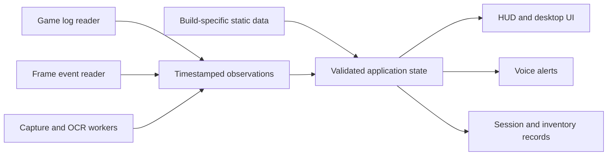

# SynthScan project analysis

Reviewed October 17, 2026. This is an analysis, not an implementation change.

This document preserves the initial code review. Subsequent HUD changes and the
results of the live console experiment are documented in
[HUD_IMPLEMENTATION.md](HUD_IMPLEMENTATION.md); source line references below refer
to the original files preserved in `backups/hud_phase1_20261017`.

## Assessment

SynthScan is a Windows companion for Star Citizen with three connected purposes: make important game and session information readable during play; maintain a personal industrial ledger with minimal typing; and preserve context useful for understanding and reporting alpha problems. Its existing UI, local records, log parsers, OCR, and overlays provide useful building blocks. The main engineering problem is the reliability and integration of the data behind those interfaces.

The current HUD obtains most live numeric measurements by reading the visible `r_DisplayInfo` text. Turning that text off removes those measurements from the capture. The existing log fallback supplies different information; it is not an alternative source for all the values in the debug block.

However, an important alternative deserves a controlled experiment: the installed executable contains `net_log_fps_interval`, accompanied by help text describing periodic server-FPS logging. This is direct evidence of a potential logging facility in this build, **not proof that the shipping client permits the command or produces the desired output**. It should be investigated before spending more effort on OCR.

## What was examined

- All project Python modules, configuration, representative persistent records, and saved screenshots.
- The installed game's build manifest, `USER.cfg`, current `Game.log`, and 80 archived game logs, approximately 1.14 GB of archived logs.
- Selected strings in the on-disk `StarCitizen.exe`; no process memory reading or executable modification.
- Archive filenames from the installed `Data.p4k`; no bulk asset extraction or game-file modification.
- Read-only Python probes of the HUD parser, health evaluator, log reader, data merging, and refinery parsing. OCR-output mocks were used to isolate quantity interpretation from recognition accuracy.
- Primary documentation for PresentMon, game server architecture, and engine console facilities.

The installed manifest identifies branch `sc-alpha-4.10.2`, build `12913470`. Conclusions about available game facilities are scoped to this installation and evidence, rather than assumed to apply to every patch.

The application was not launched for an end-to-end test. Application code, inventories, blueprint ownership, and game configuration were not edited. Existing destructive test scripts were inspected rather than executed. Python probes used `-B` to avoid rewriting project bytecode.

## Existing product and implementation

| Capability | Current implementation | Important boundary |
|---|---|---|
| Top HUD | Tkinter topmost ribbon, bitmap font matching, log fallback, shard history | Most live numbers still require visible debug text |
| Mining assistant | Screen capture, color gating, RapidOCR, RS lookup, voice, separate overlay | A recognized number is classified by rules, not independently verified as a mining signature |
| Refinery vault | Terminal/clipboard screenshot OCR, ore totals, quality batches, history | A capture is immediately added as a new haul |
| Crafting planner | Recipes and local inventory deductions | Clicking craft updates SynthScan's ledger; it does not perform or verify an in-game craft |
| Blueprint tracker | Catalog, owned library, log scanning, live award watcher, favorites | Award history is evidence of an unlock at that time, not a complete current-account snapshot |
| SynthStrings | Edits loose localization text to shorten labels and annotate blueprint rewards | A game-file-writing subsystem with its own patch and backup concerns |
| Session notebook | Join events, names, notes, location history, telemetry summaries | Session lifecycle and telemetry persistence are incomplete |

`main.py` is approximately 4,100 lines and connects almost every subsystem. `telemetry_hud.py` combines acquisition, parsing, state merging, history, health scoring, and rendering. Data sources and UI presentation therefore have considerable influence over each other.

The workspace has no Git repository, README, dependency manifest, or lockfile. Imports needed for the examined probes are available in the installed Python 3.14 environment, and the Python files passed syntax parsing. This establishes basic local readiness, not reproducible installation or application correctness.

Current records contained 520 catalog blueprints, 40 owned-library entries, and 18 stored server sessions. These counts describe local records, not independently verified game state.

## The HUD's actual data sources

| Field | Source in this project | Prospects with `r_DisplayInfo 0` |
|---|---|---|
| Region and shard identifier | Join/update events in `Game.log` | Already viable; needs robust lifecycle handling |
| New/repeat shard and notes | Local history | Viable with full shard identity and proper join events |
| Friendly shard name | Manual labels or a populated game-log record | Loading-screen OCR retired; no verified background source currently supplies CIG's two-word name |
| Location | Selected log events and hardcoded translations | Partially viable; event-based and sometimes stale or incorrectly mapped |
| Medical imprint | Manual setting or inference from medical events and location | Treat manual values as user supplied and inferred values as unconfirmed |
| Client FPS | Bitmap matching of debug text | External frame-event measurement is a credible alternative |
| Server FPS | Bitmap matching of debug text | `net_log_fps_interval` is a promising unverified logging candidate |
| Game ping | Bitmap matching; fallback TCP connection to an AWS API endpoint | The fallback is not game latency; a verified independent source is still needed |
| Packet loss and bandwidth | Bitmap matching of the network line | No working independent feed established |
| Server/shard population and restarts | Bitmap matching and cached results | No verified independent live source established |
| Entities | Bitmap matching or occasional log snapshots | Snapshots can be shown with their age, not represented as continuous live measurements |

The code's `measure_region_latency()` opens TCP port 443 on an `ec2.<region>.amazonaws.com` endpoint and times the connection, including name resolution. It does not measure the actual game socket, replication endpoint, or game-reported latency. Its description as a true shard ping is incorrect. It also assumes a relationship between game region tags and AWS service endpoints that has not been established by this investigation.

Intel's [PresentMon project](https://github.com/GameTechDev/PresentMon) documents ETW-based frame-event collection across DirectX, OpenGL, and Vulkan. That makes it a strong candidate for client FPS and frame times without reading debug pixels. It still needs a target-machine trial and a clear choice of which frame metric the HUD displays. It does not provide server FPS.

Shard identity and individual simulation-server identity should remain separate. CIG's [DGS Mesh Node description](https://robertsspaceindustries.com/en/comm-link/spectrum-dispatch/18227-Roadmap-Roundup-July-14th-2021) explicitly describes multiple dedicated game servers and clients sharing the same Hybrid service. Consequently, a server transition can occur within a shard; shard-wide population, local server population, and a local server's simulation rate need distinct labels and lifetimes.

## Important discovery: possible server-FPS logging

Static inspection of this installed executable found:

- `net_log_fps_interval`, at file offset `0x842e118`.
- An adjacent help string describing server-FPS logging at a configurable interval, with zero disabling it.
- The display format strings for server FPS, game network measurements, population, and restarts.
- Other diagnostic command names, including `net_dump_connections`, `net_dump_views_info`, `net_dump_players`, and `net_dump_territories`.

The command and its help string are a much stronger research lead than assuming the client has no logging facility. Nevertheless, compiled strings do not establish registration, whitelist status, client-side execution, current semantics, or availability to a normal shipping client. The dump commands likewise are candidates, not implemented feeds. A visible-player or replicated-entity list must not be assumed to equal the entire shard population.

A controlled next experiment should:

1. Start with an actual connected session and record the build and full shard identifier.
2. Query whether `net_log_fps_interval` is recognized and accessible.
3. If accepted, temporarily try a one-second interval while `r_DisplayInfo` is off.
4. Observe which file, if any, receives timestamped measurements. Confirm that the output represents the relevant simulation server and is not merely a client frame rate.
5. Briefly compare against the debug block, then turn it off again and confirm that fresh values continue.
6. Test a server transition and a disconnect, then restore the logging interval to zero.

No such console experiment was performed during this review. No command was added to `USER.cfg`.

Across the existing logs, targeted searches found no server-FPS stream or formatted live network-measurement stream. Broader searches for ping, population, and RTT produced tutorial notifications, mission titles, and render-to-texture diagnostics; those are not telemetry. Blueprint awards and entity snapshots were present. This finding describes existing logging, not everything the engine could potentially emit with another supported setting.

## Confirmed correctness issues

### HUD and session state

1. **Missing measurements produce an apparently healthy server.** Calling `ServerHealthEvaluator.evaluate(None)` with its default connected state returned `96`, `OPTIMAL`, and `HEALTH: 96%`. The score begins at 96 when server FPS is unavailable. This is fabricated certainty, particularly when the only other value is an unrelated TCP connection time. See `telemetry_hud.py:1177`.

2. **Zero server FPS is treated as standby.** Calling the evaluator with `0.0` returned `STANDBY`. Its early return prevents zero FPS from reaching the later stall-duration logic. The claimed bandwidth-flatline predictor also does not actually use bandwidth to make its alert decision. See `telemetry_hud.py:1145` and `telemetry_hud.py:1180`. None of the percentage or crash-risk labels have demonstrated predictive calibration.

3. **A disconnect does not reliably clear the HUD.** A reproduction fed a disconnect into the log reader, which correctly changed its shard to `--`. The HUD merge nevertheless retained the previous shard and server FPS while the game process remained running. The merge only copies a nonempty connected shard from the reader. Cached population and restart values also lack expiration. See `telemetry_hud.py:1530` and `telemetry_hud.py:1561`.

4. **Some capture and parser paths cannot meet.** The HUD captures a region only 260 pixels tall, while the entity-reading branch requires at least 305 pixels and searches around rows 270–315. That branch cannot run on the normal HUD capture. See `telemetry_hud.py:695`, `telemetry_hud.py:1507`, and `telemetry_hud.py:1519`.

5. **Monitor switching references a missing constant.** `TopTelemetryHUD.set_game_monitor()` accesses `self.COVER_WIDTH`; the class does not define it. This raises before its later geometry-update exception handler and can interrupt the broader monitor-setting operation. See `telemetry_hud.py:1467` and `main.py:277`.

6. **Turning off the HUD also stops its telemetry/log collection path.** `_scanner_loop()` gates collection on `self.top_hud.enabled`. Server history therefore depends on a presentation preference. Other features also share that worker, so OCR latency can delay HUD sampling. See `main.py:3719`.

7. **Log reading and state updates have multiple owners.** The scanner thread polls the same log reader that is polled again during the main-thread merge. Bitmap parsing and the ping thread also mutate shared HUD state. There is no single ordered owner for the complete state. A log callback can reach rendering from the scanner thread. See `main.py:3726`, `telemetry_hud.py:1323`, and `telemetry_hud.py:1530`.

8. **Partial log lines are discarded.** The reader splits every acquired chunk into lines without retaining an unfinished line. Splitting a valid join event between two chunks caused both parts to be missed in a reproduction; parsing the complete event worked. Truncation handling also does not fully reset session-derived state. See `telemetry_hud.py:879` and `telemetry_hud.py:902`.

9. **Location inference can contradict more direct evidence.** In the inspected current session, a request named `GrimHEX`, while subsequent numeric inventory-location events used an ID hardcoded as Seraphim. Replaying the log ended at `SERAPHIM STATION`. That proves the present mapping/event interpretation is unreliable; it does not establish a universal replacement mapping. Medical-imprint inference can inherit these mistakes. See `telemetry_hud.py:201` and `telemetry_hud.py:974`.

10. **Time-dependent health evaluation is coupled to drawing.** A render-cache hit returns before evaluation, so a prolonged unchanged bad reading need not advance the stall-duration calculation. Bandwidth and loss are also absent from that render cache key. Evaluate health on timestamped samples or a timer, then render its result. See `telemetry_hud.py:1639` and `telemetry_hud.py:1818`.

11. **Historical identity and session closure need work.** Shard keys truncate regions to three characters, collapsing distinctions such as `use1` and `use2`, and omit the deployment portion of the full shard name. Same-shard rejoining is not a distinct visit event in the tracker. Startup backfill assumes the final historical join is active, while `get_active_session()` falls back to the last session even if none is active. Sample summaries are exponential moving averages, and `record_telemetry_sample()` does not itself save them. See `telemetry_hud.py:794`, `server_log_manager.py:120`, `server_log_manager.py:256`, and `server_log_manager.py:336`.

### Inventory, blueprints, and industrial data

12. **Explicit SCU units can be overridden by a size heuristic.** With mocked high-confidence OCR of `Tungsten` and `750 SCU`, the parser returned `7.5 SCU`, and also assigned quality 750. It treats any value above 500 as cSCU, even when the text says SCU. With `32.00 SCU` and no quality evidence, it assigned quality 850. Recognition improvements alone will not fix these semantic errors. See `refinery_db.py:333`, `refinery_db.py:362`, and `refinery_db.py:401`.

13. **Captures are added rather than reconciled.** Every successful terminal scan calls `add_haul_record()` immediately. Scanning the same work order twice can add it twice. The parser does not establish whether the number is raw input, refined output, storage stock, a percentage, or another field before adding it. Quality for multiple same-ore observations is collapsed to one per-ore value. See `main.py:959` and `refinery_db.py:116`.

14. **The blueprint material costs are placeholders.** `generate_default_cost()` supplies category-based recipes. All 520 catalog records use only five distinct cost dictionaries, matching those defaults. The UI can use these to deduct inventory and announce fabrication. These values need verified recipe data or explicit estimated/unknown status. See `blueprint_db.py:24` and `main.py:2448`.

15. **Blueprint OCR exists but is not connected to a workflow.** `parse_fabricator_screen()` is imported into `main.py` but never called there. It recognizes names and supplies catalog/default costs; it does not actually extract material costs from the screen despite its description. A visible item name alone also does not prove ownership. See `blueprint_db.py:463` and `main.py:63`.

16. **A missing award record is not proof of a locked blueprint.** The watcher recognizes a narrow `Received Blueprint:` pattern, and the library spans multiple game builds without a reset/account epoch. Matching owned names to catalog names also permits substring matches, which can merge variants incorrectly. The catalog total has a hardcoded floor of 520. See `blueprint_db.py:157`, `blueprint_db.py:288`, and `blueprint_db.py:300`.

17. **Some test scripts mutate the real application records.** `test_crafting.py` clears the real inventory at import/execution, seeds it, and clears it again. `test_refinery.py` adds a test receipt to real inventory. These must use isolated storage before any automatic test discovery is introduced.

## What data mining can contribute

Static game data is promising for canonical item identifiers, names, recipe definitions where present, and location metadata. It is not a source of continuously changing server population, FPS, or ping.

The existing adaptation engine reads and rewrites the loose `global.ini`; its discovered blueprint names go into patch state, rather than constituting a verified recipe extraction pipeline. It does not parse DataCore into recipes.

The installed P4K index contains about 1.38 million filenames. Selected paths include crafting assets and telemetry XML configuration names. Those names alone do not demonstrate a player-accessible live telemetry feed. Standard ZIP handling rejected custom extra fields; an index-only inspection skipped extra-field decoding. **Its reported file sizes and offsets were therefore not trusted**, and no assets were extracted. Further asset work should use a compatible, maintained reader rather than treating this limited index inspection as full P4K support.

The useful sequence is: establish stable IDs, extract and validate a small set of actual recipes against the game terminal, record the build and source for each field, and only then expand the catalog. Avoid converting generic category assumptions into supposedly authoritative data.

## Integration changes that would make the features cooperate

Give acquisition and state management their own lifecycles:

Each measurement needs a value, unit, source, observation time, session identity, and validity status. Useful statuses include observed, inferred, stale, unavailable, and user supplied. For example, a 15-minute-old entity snapshot is a historical observation, not a live entity count. A manual medical imprint should not silently become a detected fact.

Use one log tailer with a partial-line buffer and explicit join, leave, loading, and server-transition events. Let it run independently of whether an overlay is visible. Workers should emit observations through a queue; the Tk main thread should own UI work. Separate fixed-font telemetry recognition from heavier terminal OCR scheduling.

For inventory, distinguish a stock snapshot from an acquisition or expenditure. Store item, quantity and unit, quality when observed, location/container when known, event identity, and source evidence. A repeated screenshot should not become a second acquisition. High-confidence captures can still import automatically once screen type, units, and duplicate identity are validated; uncertain rows need correction rather than guessed values.

For persistence, the essential requirements are atomic updates, explicit schema versions, and one writer or transactions. SQLite is a reasonable fit for the linked session and inventory records. Atomic JSON replacement with serialization is also a valid smaller first step. The present uncoordinated read/modify/write operations and broad exception suppression make failures difficult to diagnose.

Keep SynthStrings as a separate optional writer. Its two adaptation paths can rewrite the same file, and a single first-created backup is not a patch-specific original. Serialize writes, validate output before replacement, and associate backups with the installed build. This is an integration issue, not evidence of a game telemetry source.

## Recommended order of work

1. **Run the server-FPS logging experiment.** This resolves the most consequential source question. Also trial PresentMon for client frame metrics. Record unavailable fields honestly if no independent source is established.
2. **Correct misleading and stale HUD behavior.** Remove the default healthy score and false game-ping label; fix disconnect/reset handling, the capture-height mismatch, and monitor switching. Preserve clear labels for shard versus simulation server.
3. **Consolidate telemetry ownership.** One log reader, one state reducer, timestamps and source metadata, a queue to the UI, and collection independent of HUD visibility. Add fixtures for join, leave, truncation, partial lines, same-shard reconnect, and server transitions.
4. **Make inventory imports trustworthy.** Parse explicit units and terminal columns, preserve batch quality, establish work-order identity, and prevent duplicate imports. Move all test persistence to temporary files.
5. **Replace industrial placeholders.** Validate recipes and catalog ownership semantics against stable IDs and actual evidence. Wire blueprint capture into the UI only after those semantics are clear.
6. **Improve testing support.** A user-triggered incident bookmark could preserve build, full shard/server identity, timestamped recent observations, a screenshot, and a note for an Issue Council report. This is a proposed extension consistent with the testing purpose, not an existing finished feature.

There is no need to replace the entire UI or assume Python is the fundamental obstacle. First establish reliable sources and honest state. The next valuable deliverable is a small HUD that displays verified readings without the debug block, along with explicit unavailable states for anything that still lacks a source.
